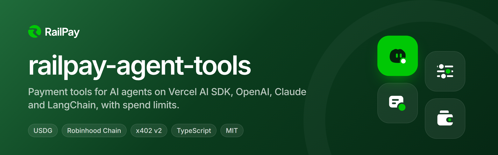

# railpay-agent-tools

Payment tools for AI agents, backed by a [RailPay](https://railpay.app) agent wallet. Your agent can check its budget, read an x402 price, pay for x402 resources and, if you allow it, pay other agents, all in USDG on Robinhood Chain and within limits you set in code.

Payments are real: USDG on Robinhood Chain (chain id 4663), using x402 v2, scheme `exact`, with EIP-3009 authorizations. Built on [railpay-sdk](https://github.com/railpayapp/railpay-sdk).

## Tools

| Tool | What it does | Spends |
|---|---|---|
| `railpay_balance` | The agent wallet: USDG balance, ETH for gas, spent today, the owner's policy, this session's limits and `max_payment_now_usdg` | no |
| `railpay_quote` | Reads the x402 price of a URL without paying: amount, recipient, and whether `railpay_fetch` would pay it within the limits. Works without a key | no |
| `railpay_fetch` | HTTP request that pays a `402` once, then returns status, body (cut at 20,000 characters) and the payment with its transaction link | yes |
| `railpay_send` | Pays another RailPay agent (`agt_…`). Off unless you pass `allowSend: true` | yes |

Each tool is a plain object: `name`, `description` (written for the model, ending with this session's limits), `inputSchema` (JSON Schema) and `execute()`. That fits the tool format of any agent framework.

## Install

The package is not on npm yet. Install the built tarball from the GitHub release:

```sh
pnpm add https://github.com/railpayapp/railpay-agent-tools/releases/download/v0.2.0/railpay-agent-tools-0.2.0.tgz
# or: npm install https://github.com/railpayapp/railpay-agent-tools/releases/download/v0.2.0/railpay-agent-tools-0.2.0.tgz
```

`npm install github:railpayapp/railpay-agent-tools` also works: it builds the package on install. pnpm 10 and later refuse to run that build for a git dependency unless `allowBuilds` in `pnpm-workspace.yaml` names the exact commit, so with pnpm use the tarball.

railpay-sdk is bundled into the build, so there are no runtime dependencies. It runs on Node 20.3+ (tested on Node 26). It uses only `fetch` and web streams, so Bun, Deno and Cloudflare Workers should work too, but they are not tested.

## Setup

1. In the [RailPay dapp](https://dapp.railpay.app), create an agent and set its policy: per-request max, daily cap, allowed hosts, allowed recipients.
2. Fund the agent wallet with USDG. For `railpay_send` it also needs a little ETH for gas.
3. Create an agent key (`rp_sk_…`) and keep it on your server.

## Quick start

### Any framework

```ts
import { createRailPayTools } from "railpay-agent-tools";

const railpay = createRailPayTools({
  apiKey: process.env.RAILPAY_AGENT_KEY, // rp_sk_… of an agent
  maxPerCall: "0.01", // USDG per payment
  sessionBudget: "0.05", // USDG for this toolkit instance
  allowedHosts: ["dapp.railpay.app"],
});

// Hand the tools to your framework: name, description, inputSchema, execute.
for (const tool of railpay.tools) console.log(tool.name, tool.inputSchema);

// Or run one by name when the model asks for it.
const result = await railpay.run("railpay_fetch", { url: "https://dapp.railpay.app/x402/time" });
if (result.ok) console.log(result.status, result.body, result.paid?.tx_url);
else console.log(result.error.code, result.error.hint);

console.log(railpay.session()); // { spent_usdg, reserved_usdg, budget_usdg, remaining_usdg }
```

`https://dapp.railpay.app/x402/time` costs 0.001 USDG and returns the server time.

### Vercel AI SDK

```ts
import { anthropic } from "@ai-sdk/anthropic";
import { generateText, isStepCount } from "ai";
import { createRailPayTools } from "railpay-agent-tools";
import { aiSdkTools } from "railpay-agent-tools/ai";

const railpay = createRailPayTools({ apiKey: process.env.RAILPAY_AGENT_KEY, maxPerCall: "0.001", allowedHosts: ["dapp.railpay.app"] });

const { text } = await generateText({
  model: anthropic("claude-opus-5-5"),
  tools: aiSdkTools(railpay),
  stopWhen: isStepCount(5),
  prompt: "Check the price of https://dapp.railpay.app/x402/time, pay it if it is 0.001 USDG or less, and tell me the time.",
});
```

`aiSdkTools()` builds the tools with the AI SDK's `tool()` and `jsonSchema()`, so no zod schemas are needed. Pass them as `tools` to `generateText` or `streamText`; the model gets the structured result object. Tested with `ai` 7.0.179 and `generateText`. Full example: [examples/ai-sdk.ts](examples/ai-sdk.ts).

## Safety model

Every payment has to pass two sets of limits, and the tightest one wins.

**On RailPay** (the agent's policy, set by the owner in the dapp, enforced by RailPay before it signs): pause switch, per-request max, daily cap, allowed hosts, allowed recipients, agent-to-agent switch. Every refusal is logged on the agent in the dapp.

**In this library** (checked before RailPay is asked to sign anything):

| Option | Default | |
|---|---|---|
| `maxPerCall` | `"0.1"` | Most USDG one payment may be. The model can pass `max_amount` to `railpay_fetch` to lower it for one call, never to raise it |
| `sessionBudget` | none | Total USDG the toolkit instance may spend. Payments in flight hold their amount, so parallel tool calls cannot overspend it |
| `allowedHosts` | any host | `railpay_quote` and `railpay_fetch` refuse other hosts before making any request. Exact match on host and port, like RailPay's own allowlist |
| `allowSend` | `false` | `railpay_send` is not offered to the model, and refuses if called anyway |

Also:

- Refusals are results, not exceptions: `{ ok: false, error: { code, message, source, retryable, hint } }`. `source` tells a local limit (`guard`) from the agent's RailPay policy (`policy`), a setup problem (`config`), bad input (`input`), a network failure (`network`) and other RailPay answers (`railpay`). The `hint` tells the model what to do next, usually "do not retry, tell the user".
- `railpay_fetch` signs only x402 `exact` payments in USDG on `eip155:4663`, and only the requirement the guard checked. It pays at most once per call, does not follow redirects, and does not let the model set `PAYMENT-SIGNATURE` or `X-PAYMENT` headers.
- A payment counts as spent once it is signed and handed to the seller, whether the seller then confirms it or not. If the paid request gets no answer, the result is a failure that still carries the `payment`, with status `unknown`, so the model does not pay twice.
- Bodies are read up to the character limit and no further. Binary responses are not inlined.

## API

### `createRailPayTools(options)`

| Option | Default | |
|---|---|---|
| `apiKey` | none | Agent key `rp_sk_…`. Not read from the environment: pass it. Without it only `railpay_quote` works |
| `client` | none | A ready `RailPay` client from railpay-sdk, instead of `apiKey` and `baseUrl` |
| `baseUrl` | `https://dapp.railpay.app` | RailPay API |
| `fetch` | global `fetch` | Used for RailPay and for the URLs the agent requests |
| `maxPerCall`, `sessionBudget`, `allowedHosts`, `allowSend` | see above | |
| `maxBodyChars` | `20000` | Response bodies are cut at this many characters |
| `timeoutMs` | `60000` | Timeout for each HTTP request a tool makes |

It returns a toolkit:

- `tools`: the tools to give the model (`railpay_send` only with `allowSend`).
- `run(name, input, { signal })`: run a tool by name. Never throws.
- `tool(name)`, `has(name)`: look a tool up. `has` is true for every RailPay tool name, so you can route calls.
- `session()`: spent, reserved, budget and remaining USDG for this instance.
- `guard`, `client`: the `SpendingGuard` and the RailPay client in use.

`resultText(result)` turns a result into the JSON string to send back to the model. Amounts are decimal USDG strings throughout.

### Tool inputs

| Tool | Input |
|---|---|
| `railpay_balance` | `{}` |
| `railpay_quote` | `{ url }` |
| `railpay_fetch` | `{ url, method?, body?, headers?, max_amount? }`. `method` is GET, POST, PUT, PATCH or DELETE |
| `railpay_send` | `{ to: "agt_…", amount: "0.05", memo? }` |

## Security

- An agent key can spend from the agent wallet within its policy. Keep it on a server, never in a browser bundle or a prompt. Pause the agent or delete the key in the dapp to cut access at once.
- Give the agent wallet only what you are willing to let the agent spend, and set a daily cap and allowlists in the dapp. The limits in this library are a second line, not a replacement.
- Tool descriptions ask the model to check with the user before paying for something the user did not ask for. A model can ignore that: the limits above are what actually bound the spend.
- Report vulnerabilities to founder@railpay.app (see [SECURITY.md](SECURITY.md)).

## Development

```sh
pnpm install
pnpm typecheck && pnpm test && pnpm build
pnpm smoke   # read-only check against https://dapp.railpay.app, no key, spends nothing
```

Tests use a mocked `fetch` for both RailPay and the seller, and mock models for the framework adapters. Nothing in the test suite touches the network.

The examples in [examples/](examples/) spend real USDG. Run them yourself, with your own keys, after `pnpm build`.

## Links

- Website: https://railpay.app
- Docs: https://docs.railpay.app
- Dapp: https://dapp.railpay.app
- SDK: https://github.com/railpayapp/railpay-sdk
- MCP server: https://github.com/railpayapp/railpay-mcp
- X: https://x.com/railpayapp

## License

[MIT](LICENSE)
